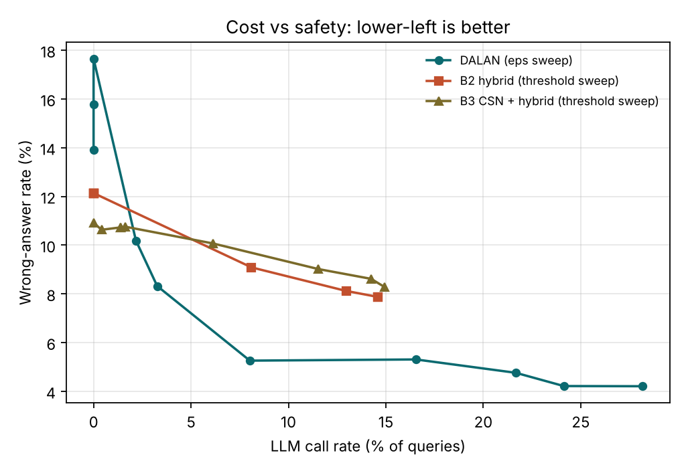

# Sugbo Guide

A fast, local tourism assistant for Cebu, Philippines, covering North Cebu, South Cebu, Metro Cebu, and local agricultural products and pasalubong. It runs on modest hardware with a small local LLM, and most answers never call the LLM at all.

This repository also contains DALAN (Dual-channel Agreement with Lexicon-Augmented Normalization), a routing algorithm that decides per query whether to answer directly from the verified knowledge base, call the local LLM, or abstain, while staying reliable on Cebuano, Tagalog, and code-switched queries. See [docs/ALGORITHM.md](docs/ALGORITHM.md).

## Results on the seed evaluation set

10 x 5-fold cross-validation on 246 queries in English, Cebuano, Tagalog, code-switched text, and out-of-domain topics. Full tables are in [results/results.md](results/results.md).

| Method | Accuracy | Wrong answers | LLM calls | Expected latency (GPU / CPU) |
|---|---|---|---|---|
| Prototype lexical rule | 77.2% | 13.0% | 0% | about 0 / 0 s |
| Always-RAG | 77.3% | 14.7% | 100% | 1.5 / 8.0 s |
| CSN + fixed hybrid | 89.3% | 10.7% | 1.5% | 0.02 / 0.1 s |
| **DALAN** | **91.8%** | **5.3%** | **7.5%** | **0.11 / 0.6 s** |

These are development results on a developer-authored seed set. See "Limitations" before citing them.

## Repository layout

    kb/build_kb.py              Knowledge base source (53 Q&A entries, 17 local products). Run to regenerate kb.json
    kb/kb.json                  Knowledge base used by every component
    dalan/                      DALAN router
      normalize.py              Stage A: code-switch normalization (folding, vowel keys, affix stripping, damped projection)
      lexicon.py                Cebuano and Tagalog tourism lexicon with English glosses
      channels.py               Stage B: lexical and character channels, rank fusion, optional dense channel
      calibrate.py              Stages C and D: logistic calibrator, risk-controlled per-language thresholds
      router.py                 DALANRouter: fit() and route()
    data/build_queries.py       Builds data/queries.jsonl, the seed code-switched evaluation set
    experiments/run_experiments.py   Cross-validation, baselines, ablations, Pareto sweep, significance tests
    results/                    Generated results (results.md, summary.csv, pareto.csv, pareto.png)
    backend/app.py              FastAPI server using DALAN (or the older hybrid rule), local LLM, Messenger webhook
    backend/router.py, eval.py  Prototype keyword router and its quick test
    web/sugbo-guide.html        Self-contained browser prototype (open directly, no server)
    web/page.html, router.js    Sources for the browser prototype
    tests/test_dalan.py         Unit tests

## Quick start

    python -m venv .venv && source .venv/bin/activate      (Windows: .venv\Scripts\activate)
    pip install -r backend/requirements.txt

    python tests/test_dalan.py                  # unit tests
    python experiments/run_experiments.py       # reproduces results/ in about 30 seconds

Run the bot with a local model (Ollama shown; llama.cpp and vLLM work through their OpenAI-compatible endpoints):

    ollama pull qwen2.5:7b-instruct             # check for newer small multilingual models first
    cd backend && uvicorn app:app --port 8000
    curl -X POST localhost:8000/chat -H "Content-Type: application/json" -d '{"question":"Asa ko makapalit og danggit?"}'

Environment variables: ROUTER (dalan or hybrid), DALAN_EPS (skip error budget, default 0.05), LLM_BASE_URL, LLM_MODEL, USE_EMBEDDINGS (1 enables the semantic cache, needs sentence-transformers), FB_VERIFY_TOKEN and FB_PAGE_TOKEN for Messenger.

## Updating content

Edit kb/build_kb.py and run it. Add new Cebuano or Tagalog words to dalan/lexicon.py. Add real user questions to data/build_queries.py and rerun the experiments. The browser prototype is rebuilt from web/page.html, web/router.js, and kb/kb.json:

    python -c "p=open('web/page.html').read().replace('/*__ROUTER__*/',open('web/router.js').read()).replace('/*__KB__*/null',open('kb/kb.json').read());open('web/sugbo-guide.html','w').write(p)"

## Limitations

- The seed queries were written by the developers, and the lexicon was extended while reviewing errors on the same queries. Expect lower numbers on real traffic. Collect real tourist queries (Messenger logs, tourism office FAQs, field collection), label them with at least two annotators, and keep a held-out test set untouched by lexicon or threshold tuning.
- LLM answer quality is modeled with stated assumptions (90% correct with the right context, 70% correct refusals without). Measure these with the deployed model.
- Fares, fees, and schedules in the knowledge base are approximate and must be verified with DOT Region VII, the Cebu Provincial Tourism Office, LGUs, and operators before public use.

## Author

Ken D. Gorro, Center for Cloud Computing, Big Data and AI, Cebu Technological University, Carmen Campus.
